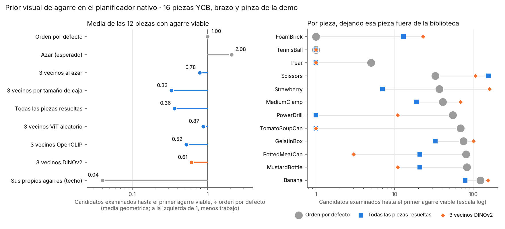

# Prior visual de agarre: DINOv2, DINOv3 y OpenCLIP en el planificador

Estado: **INTEGRADO Y EVALUADO**. Las características de un modelo de visión congelado ordenan la búsqueda
del planificador nativo de agarres. La evaluación deja fuera una pieza cada vez.

> **Prueba con piezas nuevas ([informe](new_parts/README.md)).** Con un protocolo fijado antes, en 50
> piezas nuevas de Google Scanned Objects (37 con agarre viable), combinar DINOv3 con el tamaño **no mejora
> de forma medible** al tamaño solo (0,98 [0,72–1,36]) ni a DINOv3 solo (0,91 [0,71–1,15]). Lo robusto es
> que transferir agarres de piezas parecidas reduce a menos de la mitad los candidatos examinados frente al
> orden por defecto (tamaño 0,40, DINOv3 + tamaño 0,39, DINOv3 0,43). Las vistas de la Fase III no ven la
> escala, y en esta celda lo que manda es el tamaño.
>
> **Segunda prueba, con renders que conservan la escala ([informe](scale/README.md)).** Otras 50 piezas nuevas
> (39 con agarre viable) y un protocolo nuevo fijado antes. Que la cámara esté a la misma distancia para todas
> las piezas no ayuda: DINOv3 con escala da 1,24 [0,85–1,85] frente al tamaño y 1,14 [0,89–1,48] frente al
> DINOv3 normalizado. El tamaño de caja vuelve a ser lo mejor medido (0,37 [0,19–0,67] frente al orden por
> defecto). Lo que sigue es la evaluación de desarrollo, con 16 piezas YCB.

## Qué hace

1. Se renderizan 16 vistas de la pieza con el método de la Fase III: gris neutro, sombreado por cara,
   órbita a 25° y 96 px ([render_cpu.py](../../../research_grasping/phase3/render_cpu.py)).
2. Un modelo congelado (DINOv2, DINOv3 u OpenCLIP, con revisión y hashes fijados) da un descriptor
   por vista, y se usa su media normalizada.
3. Se buscan las 3 piezas ya resueltas con el descriptor más parecido (coseno). Una pieza resuelta es
   una cuyo catálogo entero se ha probado en el planificador y tiene al menos un agarre viable.
4. Cada candidato de la pieza nueva recibe una puntuación entre 0 y 1: lo cerca que está de los agarres
   viables de esas vecinas. Las etiquetas de candidato dependen de la malla ("surface 26 across 7"), así
   que la comparación usa una firma del agarre: dirección de aproximación, eje de cierre (sin signo),
   apertura, y posición y altura del centro en la caja de la pieza.
5. Las puntuaciones forman el fichero de `axisforge plan --prior`. **Solo cambian el orden en que se
   examinan los candidatos.** Cinemática inversa, colisiones, cierre de fuerzas y elevación se
   comprueban igual en cada candidato. Un prior malo cuesta tiempo, nunca un agarre malo.
   Las pruebas de `crates/grasping/tests/prior.rs` lo comprueban: mismo veredicto con y sin prior, y un
   candidato favorecido que falla sigue rechazado.

Código: [visual_prior.py](../../../research_grasping/phase4/visual_prior.py) (biblioteca),
[tools/research/phase4/visual_prior.py](../../../tools/research/phase4/visual_prior.py) (órdenes),
[pruebas](../../../tests/phase4/test_visual_prior.py).

## Uso

```bash
T="python tools/research/phase4/visual_prior.py"
B=target/release/axisforge
# 1. Vistas de las piezas (sin modelo; CPU, de 5 a 20 s por pieza)
$T views --part Banana cells/Banana/cell.axisforge --part Pera cells/Pera/cell.axisforge --out views.zip
# 2. Descriptores (aquí con DINOv2; en Colab también DINOv3)
$T encode --views views.zip --model dinov2 --checkpoint dinov2-small \
  --revision ed25f3a31f01632728cabb09d1542f84ab7b0056 \
  --weights-sha256 ae1e99fcefd534ed978cdeb8326f08030c96e28b7a81ffcbc98a857c84d14be1 \
  --config-sha256 1809f83e3bdb1609a501a610ad4a742f4fd8ae44d72ca4aa0df52d1f2ac8628d \
  --processor-sha256 14e780d86fa1861f8751f868d7f45425b5feb55c38ca26f152ca5097ab30f828 --out dinov2.npz
# 3. Biblioteca: cada pieza se resuelve entera (de 1 a 15 s por pieza)
$T library --binary $B --part Banana cells/Banana/cell.axisforge ... --descriptors dinov2.npz --out library.json
# 4. Prior para una pieza nueva y plan con él
$T prior --library library.json --binary $B --part Pera cells/Pera/cell.axisforge \
  --descriptors dinov2.npz --model dinov2 --out pera-prior.json
$B plan cells/Pera/cell.axisforge Pera --prior pera-prior.json
```

`prior --method box` elige las vecinas por tamaño de caja y `--method pooled` usa todas las piezas
resueltas. Ninguno de los dos necesita modelo de visión. La [biblioteca](library.json) de las 16 piezas
YCB sirve de punto de partida para piezas propias en la misma celda: trae los agarres viables y los
descriptores DINOv2, OpenCLIP y del control aleatorio.

### DINOv3

Aquí se usa la copia que redistribuye timm bajo la licencia DINOv3 (`--model dinov3-timm`, revisión y hashes en
[el panel DINOv3](../embedding_experiment/dinov3/README.md)), sin formulario de acceso. Usarla supone aceptar
esa licencia. El checkpoint de Meta en Hugging Face (`facebook/dinov3-vits16-pretrain-lvd1689m`) sigue
restringido: hace falta que Meta apruebe tu cuenta. Para usar ese en Colab, el
[notebook](../../../notebooks/AxisForge_Phase4_Frozen_Foundation_Models.ipynb) explica los pasos: solicitar acceso, crear un token de lectura y guardarlo como secreto `HF_TOKEN` con
acceso del notebook. Después se añade `'dinov3'` a `MODELS`, se sube `views.zip` y el notebook devuelve
`dinov3_descriptors.npz`. Con ese fichero, los pasos 3 y 4 usan `--descriptors dinov3_descriptors.npz
--model dinov3`. La celda se verificó en local, de principio a fin, con el DINOv2 oficial: los 16
descriptores coinciden exactamente con los de la CPU
([informe](../automation/notebook_visual_prior.json)).

## Evaluación

Las 16 piezas YCB de los escenarios GRASPA ([tools/verify/ycb_pick.sh](../../../tools/verify/ycb_pick.sh))
se colocan solas en la mesa de la demo. Cada catálogo, de 798 a 1 432 candidatos, se probó entero:
12 piezas tienen algún agarre viable (de 2 a 140) y 4 ninguno (dos latas más anchas que la carrera de la
pinza, la caja de galletas y el martillo, fuera del alcance del brazo). Para cada una de las 12, su
prior sale **solo de las otras 15 piezas**, y se cuentan los candidatos que examina el planificador
hasta el primer agarre viable (y hasta el tercero, en las 10 piezas que tienen al menos tres).

Los parámetros se fijaron antes de ejecutar y no se ajustaron después: 3 vecinas, peso 2, y 30° de
aproximación o de eje de cierre, 1 cm de apertura, un cuarto de la caja o 2 cm de altura por unidad de
distancia. Comparaciones:

- **Orden por defecto**: el del planificador, sin prior.
- **Azar (esperado)**: la posición esperada del primer viable en un orden aleatorio, (N+1)/(F+1).
- **3 vecinas al azar** (media de 10 semillas), **3 vecinas por tamaño de caja** (log de las dimensiones)
  y **todas las piezas resueltas** por igual: referencias sin visión.
- **ViT con pesos aleatorios**: la misma arquitectura DINOv3 ViT-S/16 sin entrenar, como control de que
  importa el preentrenamiento y no solo la imagen.
- **Sus propios agarres**: el techo del mecanismo de transferencia (no es una transferencia).

Candidatos examinados, cociente frente al orden por defecto (media geométrica; menos de 1 es mejor):

| Prior | Hasta el 1.er viable (12 piezas) | Mediana | Mejor que defecto | Hasta el 3.er viable (10 piezas) | Mediana | Mejor que defecto |
|---|---:|---:|---:|---:|---:|---:|
| Orden por defecto | 1 | 48 | — | 1 | 82 | — |
| Azar (esperado) | 2,08 | 34,2 | 6 | 2,42 | 87,0 | 2 |
| 3 vecinas al azar | 0,78 | 25,0 | 6 | 0,76 | 35,7 | 6 |
| ViT aleatorio | 0,87 | 65 | 3 | 0,79 | 49 | 3 |
| OpenCLIP | 0,52 | 18 | 5 | 0,57 | 27 | 5 |
| **DINOv2** | **0,61** | **17** | **5** | **0,46** | **17** | **6** |
| Tamaño de caja | 0,33 | 9 | 7 | 0,54 | 18 | 6 |
| Todas las piezas | 0,36 | 16 | 9 | 0,53 | 27 | 7 |
| Sus propios agarres | 0,04 | 1 | 10 | 0,07 | 3 | 9 |



Lectura, descriptiva y sin pretensión estadística (12 piezas, una celda, una pinza):

- El mecanismo funciona. Con los agarres correctos, el planificador encuentra uno viable en el primer
  candidato en las 12 piezas. Y el orden por defecto deja mucho margen: en la mitad de las piezas es
  peor que un orden al azar. Favorece candidatos que el brazo no alcanza (la mayoría de los rechazos
  previos al primer viable son `pregrasp_unreachable` o `lift_unreachable`) o que, en la banana,
  chocan con la mesa al acercarse.
- Las características preentrenadas aportan señal. Con DINOv2 u OpenCLIP, las vecinas dan priors mucho
  mejores que con un ViT sin entrenar o elegidas al azar, y DINOv2 es el mejor prior transferido hasta
  el tercer agarre viable (mediana 17 frente a 82).
- Pero en esta celda **la semejanza visual no supera a referencias simples**. Hasta el primer viable,
  elegir vecinas por tamaño de caja o juntar todas las piezas resueltas va igual o mejor. Lo que decide
  la viabilidad aquí es sobre todo geométrico: el alcance del brazo, la mesa y una carrera de 80 mm.
  Una caja lo resume directamente. La semejanza visual, en cambio, junta la fresa con la pelota y la
  pera, cuyos agarres buenos no sirven para una pieza de su tamaño (161 candidatos frente a 3 por caja).
  Donde la forma importa más que el tamaño, acierta: la lata de carne con la de tomate (3 frente a 81
  por defecto) y la botella de mostaza (11 frente a 83).
- No hay base para declarar un modelo mejor que otro, ni DINOv2 frente a OpenCLIP. Combinar las
  vecinas visuales con el tamaño es el siguiente paso natural, pero ajustarlo sobre estas 12 piezas
  sería sobreajuste. Debe probarse con piezas nuevas.

Tiempo: la evaluación completa (374 planificaciones) tarda unos 15 minutos en CPU con un hilo.
Repetirla desde la biblioteca versionada da exactamente las mismas filas ([evaluation.json](evaluation.json)).

## Reproducir

```bash
tools/verify/ycb_pick.sh target/release/axisforge /ruta/ycb   # descarga las mallas y crea las celdas
T="python tools/research/phase4/visual_prior.py"
$T evaluate --library research/phase4/grasp_prior/library.json --projects /ruta/ycb \
  --binary target/release/axisforge --model dinov2 --model openclip --model vit-random --out evaluation.json
python tools/research/phase4/plot_visual_prior.py --evaluation evaluation.json --out visual_prior.png
```

La biblioteca trae las rutas relativas a esa carpeta (`Banana/cell.axisforge`) y los hashes de cada
proyecto. Los descriptores versionados son [dinov2.npz](dinov2.npz), [openclip.npz](openclip.npz) y
[vit-random.npz](vit-random.npz). Cada uno lleva la procedencia del codificador: revisión y hashes de
los pesos, y el hash del ZIP de vistas.

Atribución: modelos YCB (Calli et al., 2015; CC BY 4.0), en la versión de `pybullet-object-models`
(LGPL-2.1). Las mallas y las vistas no se redistribuyen; aquí solo hay descriptores numéricos y agarres.
DINOv2 (Meta, Apache-2.0), OpenCLIP ViT-B/32 QuickGELU LAION-400M e31 (ML Foundations, MIT). Los pesos
no se redistribuyen.
