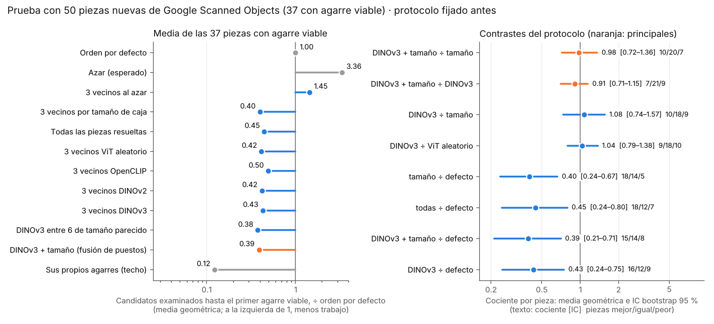

# Prueba con 50 piezas nuevas: visual + tamaño

Estado: **EJECUTADO** según el [protocolo](PROTOCOL.md), fijado y subido (commit `75bec22`) antes de
resolver ninguna pieza nueva. Nada se ha cambiado después: ni parámetros, ni contrastes, ni piezas.

## Qué se hizo

- **Piezas**: 50 de Google Scanned Objects, sorteadas con semilla fija entre los 1000 modelos que el proyecto
  no había usado. Se excluyeron los 30 de la Fase III, incluidos los 8 de test sellados. Solo se filtró por
  tamaño de caja: se examinaron 133 y la CLI no rechazó ninguna ([new_parts.json](new_parts.json)). 37
  tienen algún agarre viable con el brazo y la pinza de la demo (de 2 a 300); las otras 13, ninguno.
- **Biblioteca**: las 16 piezas YCB y las 50 nuevas, cada una resuelta entera: 66 piezas, de 798 a 1 434
  candidatos cada una ([library.json.gz](library.json.gz)).
- **Evaluación**: cada una de las 37 piezas se evalúa con su prior sacado de las otras 65. 1 846
  planificaciones en 8 minutos, 4 hilos ([evaluation.json](evaluation.json)). Descriptores:
  [DINOv2](dinov2.npz), [OpenCLIP](openclip.npz), [DINOv3](dinov3.npz) y un [ViT sin entrenar](vit-random.npz).
- **Análisis**: el fijado en el protocolo ([analysis.json](analysis.json)).

## Resultado



**Contrastes principales: no demostrado.** Candidatos examinados hasta el primer agarre viable, cociente
emparejado por pieza (media geométrica, IC bootstrap 95 %, piezas mejor/igual/peor):

| Contraste | Cociente | IC 95 % | Mejor/igual/peor | p de Holm |
|---|---:|---|---:|---:|
| DINOv3 + tamaño ÷ tamaño solo | 0,98 | 0,72–1,36 | 10/20/7 | 1,00 |
| DINOv3 + tamaño ÷ DINOv3 solo | 0,91 | 0,71–1,15 | 7/21/9 | 1,00 |

Combinar apariencia y tamaño no mejora de forma medible a ninguno de los dos por separado. Hasta el
tercer agarre viable pasa lo mismo: 0,97 [0,78–1,25] frente al tamaño y 0,86 [0,73–1,01] frente a DINOv3.

**Lo que sí es robusto: transferir agarres ahorra trabajo.** Frente al orden por defecto, cualquier prior
con vecinas elegidas con criterio reduce a menos de la mitad los candidatos examinados:

| Prior | Hasta el 1.er viable | IC 95 % | Mejor/igual/peor | Hasta el 3.er viable |
|---|---:|---|---:|---:|
| DINOv3 + tamaño (fusión) | 0,39 | 0,21–0,71 | 15/14/8 | 0,46 |
| Tamaño de caja | 0,40 | 0,24–0,67 | 18/14/5 | 0,48 |
| DINOv2 | 0,42 | 0,24–0,72 | 15/13/9 | 0,49 |
| DINOv3 | 0,43 | 0,24–0,75 | 16/12/9 | 0,54 |
| Todas las piezas resueltas | 0,45 | 0,24–0,80 | 18/12/7 | 0,54 |
| OpenCLIP | 0,50 | 0,28–0,85 | 16/12/9 | 0,59 |
| 3 vecinas al azar (control) | 1,45 | — | — | 1,18 |
| Sus propios agarres (techo) | 0,12 | 0,07–0,24 | 23/14/0 | 0,23 |

Todos los de la tabla, salvo el control al azar, tienen p < 0,05 frente al defecto (sin corregir; son
contrastes secundarios). En 14 de las 37 piezas el orden por defecto ya acierta a la primera, y ahí no hay
nada que ganar. Donde el defecto falla mucho, el prior ayuda mucho: en la tabla de clasificación
geométrica, 475 candidatos con el defecto, 349 con el tamaño y 23 con DINOv3 + tamaño. En el cartucho de
tinta HP, 117 con el defecto y 1 con la fusión.

## Por qué la apariencia no añade nada aquí

- **Las vistas no ven el tamaño.** El render de la Fase III coloca la cámara a 1,5 veces la diagonal de la
  caja, con la focal fija. Todas las piezas ocupan lo mismo en la imagen, así que el descriptor es ciego a
  la escala por construcción. En estas 66 piezas, el parecido visual apenas se correlaciona con la diferencia
  de volumen (|r| < 0,09 con DINOv2, DINOv3 y el ViT aleatorio). Y lo que decide un agarre con esta pinza y
  este brazo es sobre todo métrico: apertura de 80 mm, alcance y altura sobre la mesa.
- **El preentrenamiento no se nota.** DINOv3 frente al mismo ViT sin entrenar da 1,04 [0,79–1,38]. En las
  12 piezas YCB el preentrenado salía por delante (0,75), pero con un intervalo que ya incluía el 1
  (0,27–2,06). Con 37 piezas nuevas, la diferencia desaparece. El ViT
  aleatorio también agrupa por silueta y proporciones, y eso parece bastar.
- **Elegir vecinas con criterio sí importa.** Con 3 vecinas al azar, el planificador examina más candidatos
  que con su propio orden (1,45). Cualquier criterio razonable (tamaño, apariencia o ambos) lo baja a ~0,4.

## Recomendación

- Para planificar piezas nuevas en esta celda, `visual_prior.py prior --method box` (sin modelo de visión) o
  `--method fusion` rinden igual y ahorran del orden de un 60 % de candidatos frente al orden por defecto.
  `box` es lo más barato.
- Los modelos de visión podrían aportar en otra situación: pinzas o manos donde la forma local importe más
  que el tamaño, o descriptores que conserven la escala. Por ejemplo, un render a distancia fija, o pasar el
  tamaño métrico al propio descriptor. Eso es una hipótesis nueva y necesitaría otra prueba con otras piezas.

## Reproducir

```bash
# catálogo fijado (sin descargar los modelos)
git init gso && cd gso && git remote add origin https://github.com/kevinzakka/mujoco_scanned_objects.git
git fetch --depth 1 --filter=blob:none origin 6ff8d275cebfd5b47e49685e3cfbe64b20e49a3c
git ls-tree --name-only 6ff8d275cebfd5b47e49685e3cfbe64b20e49a3c models/ > ../catalogue.txt && cd ..
python tools/research/phase4/new_parts.py --catalogue catalogue.txt \
  --exclude research/phase3/dataset/manifest.lock.json --binary target/release/axisforge --out /ruta/gso
tools/verify/ycb_pick.sh target/release/axisforge /ruta/ycb
# /ruta/pool/ycb -> /ruta/ycb y /ruta/pool/gso -> /ruta/gso (rutas de la biblioteca)
python tools/research/phase4/visual_prior.py evaluate \
  --library research/phase4/grasp_prior/new_parts/library.json.gz --projects /ruta/pool \
  --binary target/release/axisforge --query ... (las 50 de new_parts.json) \
  --model dinov2 --model openclip --model dinov3 --model vit-random --methods visual fusion gate --jobs 4 \
  --out evaluation.json
python tools/research/phase4/grasp_prior_stats.py --evaluation evaluation.json \
  --primary fusion:dinov3 box --primary fusion:dinov3 visual:dinov3 --secondary ... --out analysis.json
```

`new_parts.json` guarda el hash de cada malla descargada y de cada proyecto, para comprobar una descarga
nueva contra ellos. El SHA-256 de `library.json` descomprimido
(`ed2721ff5ff567e5ab096b2047b450de107cb3fbce7de3bb96333c36380a8482`) es el que registra la evaluación.

Atribución: Google Scanned Objects (Downs et al., 2022), adaptación MuJoCo de Kevin Zakka, CC BY 4.0; YCB
(Calli et al., 2015; CC BY 4.0) vía `pybullet-object-models`. Las mallas y las vistas no se redistribuyen.
DINOv2 (Apache-2.0), OpenCLIP (MIT), DINOv3 (licencia DINOv3, copia de timm). Los pesos no se redistribuyen.
