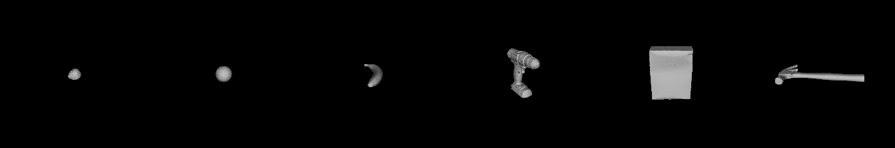
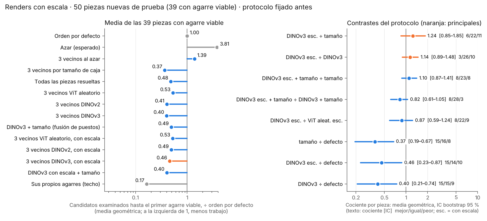

# Renders que conservan la escala: segunda prueba con 50 piezas nuevas

Estado: **EJECUTADO** según el [protocolo](PROTOCOL.md), fijado y subido (commit `df48486`) antes de resolver
ninguna pieza de prueba. Ni parámetros, ni contrastes, ni piezas se cambiaron después.

## Pregunta

En la [primera prueba](../new_parts/README.md), la apariencia no mejoró al tamaño de caja, y una causa clara era
que las vistas de la Fase III normalizan la escala: la cámara se pone a 1,5 veces la diagonal de cada pieza.
Aquí la cámara está **a 0,6 m de todas las piezas**, con las mismas intrínsecas y 224 px, así que el tamaño
real se ve en la imagen:



Con estas vistas, el parecido visual sí depende del tamaño. La correlación entre el coseno y la diferencia de
volumen pasa de −0,09 a −0,22 con DINOv3, −0,25 con DINOv2 y −0,41 con el ViT sin entrenar.

## Qué se hizo

- **Desarrollo**: las 66 piezas ya vistas (16 YCB y 50 GSO), 49 de ellas con agarre viable. En desarrollo
  no hubo mejora clara frente al tamaño ([evaluación](development/evaluation.json),
  [análisis](development/analysis.json)), y así quedó escrito en el protocolo.
- **Prueba**: 50 piezas GSO nuevas, con la semilla 20261127. Se excluyen las de la Fase III y las de la primera
  prueba: 214 examinadas, ninguna rechazada por la CLI y ninguna compartida
  ([test_parts/new_parts.json](test_parts/new_parts.json)). 39 tienen algún agarre viable (de 2 a 287); los
  catálogos tienen de 954 a 1 716 candidatos.
- Biblioteca de 116 piezas; cada pieza de prueba saca su prior de las otras 115. Son 1 950 planificaciones en
  6 minutos con 4 hilos. Descriptores de prueba con escala y normalizados, de DINOv3, DINOv2 y el ViT sin
  entrenar, en [test/](test/).

## Resultado



**Contrastes principales: no demostrado, y la estimación va en contra.** Candidatos examinados hasta el primer
agarre viable, cociente emparejado por pieza:

| Contraste | Cociente | IC 95 % | Mejor/igual/peor | p de Holm |
|---|---:|---|---:|---:|
| DINOv3 con escala ÷ tamaño de caja | 1,24 | 0,85–1,85 | 6/22/11 | 0,38 |
| DINOv3 con escala ÷ DINOv3 normalizado | 1,14 | 0,89–1,48 | 3/26/10 | 0,38 |

Secundarios, descriptivos:

| Contraste | Hasta el 1.er viable | Hasta el 3.er viable |
|---|---|---|
| DINOv3 con escala + tamaño ÷ tamaño | 1,10 [0,87–1,41] | 1,00 [0,87–1,14] |
| DINOv3 con escala + tamaño ÷ DINOv3 normalizado + tamaño | 0,82 [0,61–1,05] | 0,87 [0,70–1,05] |
| DINOv3 con escala ÷ ViT sin entrenar con escala | 0,87 [0,59–1,24] | 1,02 [0,78–1,33] |
| ViT sin entrenar con escala ÷ tamaño | 1,43 [1,03–2,01] | 1,16 [0,90–1,51] |
| Tamaño de caja ÷ orden por defecto | **0,37 [0,19–0,67]** | **0,43 [0,26–0,70]** |
| DINOv3 con escala ÷ defecto | 0,46 [0,23–0,87] | 0,51 [0,30–0,85] |
| DINOv3 normalizado ÷ defecto | 0,40 [0,21–0,74] | 0,47 [0,28–0,76] |
| Sus propios agarres (techo) ÷ defecto | 0,17 [0,09–0,30] | 0,26 [0,16–0,43] |

En 18 de las 39 piezas, el orden por defecto ya acierta a la primera.

## Lectura

- **Dos pruebas independientes dicen lo mismo.** En esta celda, con esta pinza, las vecinas por tamaño de caja
  son la mejor opción medida: cuestan menos y rinden igual o mejor que cualquier descriptor visual. Ver el
  tamaño en la imagen no lo cambia; el descriptor visual sigue por detrás, aunque sin diferencia significativa.
- **Transferir agarres sí sirve.** Con el tamaño, el planificador examina en media un 63 % menos de candidatos
  hasta el primer agarre viable (0,37 [0,19–0,67]). Con vecinas al azar, examina más que con su propio orden (1,39).
- **Indicio sin confirmar.** Combinada con el tamaño, la versión con escala va algo mejor que la normalizada
  (0,82 [0,61–1,05]), pero ninguna combinación supera al tamaño solo. Haría falta una tercera prueba fijada
  antes; no se declara nada.
- **El preentrenamiento sigue sin notarse** frente al mismo ViT sin entrenar (0,87 [0,59–1,24]).

**Recomendación:** `visual_prior.py prior --method box`. Los modelos de visión quedan integrados y probados,
pero para elegir vecinas en esta celda no aportan nada medible sobre el tamaño. Donde podrían aportar
(otras pinzas o manos, piezas del mismo tamaño y distinta forma, contacto local) sería otra hipótesis.

## Reproducir

Las piezas de prueba se reconstruyen con `new_parts.py --seed 20261127 --also-exclude
research/phase4/grasp_prior/new_parts/new_parts.json` (mismo catálogo y regla). Biblioteca:

```bash
T="python tools/research/phase4/visual_prior.py"
$T add-descriptors --library research/phase4/grasp_prior/new_parts/library.json.gz \
  --descriptors research/phase4/grasp_prior/scale/development/dinov3-metric.npz \
  --descriptors research/phase4/grasp_prior/scale/development/dinov2-metric.npz \
  --descriptors research/phase4/grasp_prior/scale/development/vit-random-metric.npz --out dev.json
$T merge --library dev.json --library research/phase4/grasp_prior/scale/test/test-library.json.gz --out library.json
$T evaluate --library library.json --projects /ruta/pool --binary target/release/axisforge --query ... \
  --model dinov3-metric --model dinov2-metric --model vit-random-metric --model dinov3 --model dinov2 \
  --model vit-random --methods visual fusion --random-seeds 10 --jobs 4 --out evaluation.json
```

`dev.json` reproduce el SHA-256 `1358cb06…` registrado en el protocolo. La biblioteca unida tiene el mismo
contenido que la evaluada. La evaluación se repitió desde la reconstruida y dio exactamente las mismas filas
([evaluation.json](test/evaluation.json)).

Atribución: Google Scanned Objects (Downs et al., 2022), adaptación MuJoCo de Kevin Zakka, CC BY 4.0; YCB vía
`pybullet-object-models`. Las mallas y las vistas no se redistribuyen, salvo la tira de muestra de seis piezas
YCB. DINOv2 (Apache-2.0), DINOv3 (licencia DINOv3, copia de timm). Los pesos no se redistribuyen.
