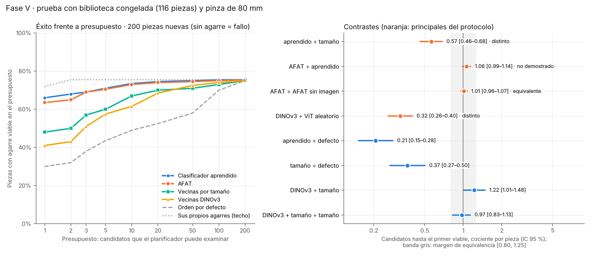

# Fase V — resultados

Estado: **EJECUTADO** según el [protocolo](PROTOCOL.md), subido en el commit `ad9e1d2` antes de resolver
ninguna de las 200 piezas de prueba. No se cambió nada después: ni parámetros, ni contrastes, ni piezas.
Responde a la revisión de la Fase IV ([respuesta punto por punto](RESPONSE.md)).



## Pregunta y respuesta corta

¿Justifica un modelo fundacional de visión (DINOv3) su uso para ordenar la búsqueda de agarres, frente a
priors geométricos y aprendidos, bajo las restricciones cinemáticas de una celda real?

**En esta celda, no.**

- Lo que más ahorra es un **clasificador aprendido de candidatos**: aprende de los catálogos resueltos de la
  biblioteca qué agarres puede hacer el brazo. Examina **0,21 [0,15–0,28]** de los candidatos del orden por
  defecto y **0,57 [0,46–0,69]** de los de las vecinas por tamaño.
- **Añadir DINOv3 no cambia nada medible**: AFAT con y sin imagen son equivalentes, 1,01 [0,96–1,07], dentro
  de ±7 %.
- El preentrenamiento sí importa **si** se buscan vecinas por apariencia: DINOv3 frente al mismo ViT sin
  entrenar, 0,32 [0,26–0,40]. Pero buscar por apariencia es peor que buscar por tamaño: 1,22 [1,01–1,48].

## Datos y método

- **Biblioteca congelada**: 116 piezas (16 YCB y 100 GSO de la Fase IV), cada una resuelta entera con
  pinzas de 40, 80 y 120 mm.
- **Prueba**: 200 piezas GSO nuevas (semilla 20261128) que nunca entran en la biblioteca. Con 80 mm,
  151 tienen algún agarre viable.
- **Medición**: cada ordenación se calcula con el simulador exacto del orden del planificador.
  - Reproduce las 6 788 ejecuciones registradas en la Fase IV ([validación](simulator_validation.json)).
  - En la prueba, **800 ejecuciones reales** de `axisforge plan --prior` (default, box, learned y AFAT ×
    200 piezas) dieron **0 diferencias** ([confirmación](results/planner_confirmation.json)).
- **Unidad de análisis**: la pieza. Las piezas de prueba no están en la biblioteca, así que sus resultados
  son independientes dada la biblioteca. Las 96 819 filas no son 96 819 observaciones independientes.

## Contrastes principales (experimento B, 80 mm, 151 piezas viables)

| | Contraste | Cociente | IC 95 % | Mejor/igual/peor | p Holm | Decisión |
|---|---|---:|---|---:|---:|---|
| P1 | aprendido ÷ tamaño | 0,565 | 0,462–0,685 | 51/91/9 | < 0,0001 | **superior** |
| P2 | AFAT ÷ aprendido | 1,058 | 0,986–1,142 | 10/123/18 | 0,13 | no demostrado |
| P3 | AFAT ÷ AFAT sin imagen | 1,011 | 0,959–1,070 | 11/127/13 | — | **equivalentes** (±25 %) |
| P4 | DINOv3 ÷ ViT aleatorio (5 semillas) | 0,322 | 0,259–0,399 | 108/13/30 | < 0,0001 | **superior** |

Las cuatro decisiones se mantienen sin las 52 variantes de producto (112 piezas viables) y sin las 126 piezas
marcadas como casi duplicadas (54 viables) ([sin variantes](results/analysis_without_variants.json),
[sin marcadas](results/analysis_without_flagged.json)).

## Frente al orden por defecto, en todas las condiciones

Cociente de candidatos hasta el primer agarre viable (IC 95 %); * = Holm < 0,05 en la familia de 464
secundarios. A: biblioteca solo YCB (entre datasets). B: biblioteca congelada. C: la biblioteca excluye la
categoría oficial de la pieza.

| | B 80 mm | B 40 mm | B 120 mm | A 80 mm | C 80 mm |
|---|---|---|---|---|---|
| Piezas viables | 151 | 58 | 157 | 151 | 133 |
| Aprendido | 0,21 [0,15–0,28]* | 0,28 [0,17–0,46]* | 0,30 [0,22–0,40]* | 0,28 [0,21–0,37]* | 0,22 [0,16–0,29]* |
| AFAT | 0,22 [0,16–0,30]* | 0,32 [0,18–0,54] | 0,28 [0,22–0,37]* | 0,27 [0,20–0,37]* | 0,23 [0,17–0,32]* |
| Tamaño | 0,37 [0,27–0,50]* | 0,37 [0,23–0,62] | 0,52 [0,39–0,67]* | 0,64 [0,45–0,92] | 0,51 [0,37–0,71] |
| DINOv3 | 0,45 [0,32–0,62]* | 0,50 [0,29–0,87] | 0,63 [0,47–0,84] | **1,44** [1,09–1,91] | 0,47 [0,34–0,66]* |
| AFAT ÷ sin imagen | 1,01 [0,96–1,07] | 1,07 [0,92–1,25] | 0,95 [0,91–1,00] | 1,01 [0,93–1,10] | 1,06 [0,97–1,17] |

- El clasificador aprendido se mantiene en todas las condiciones, incluso aprendiendo solo de 16 piezas
  YCB (A) o sin ver la categoría de la pieza (C).
- Por categorías (C, 80 mm): Consumer Goods 0,17, Toys 0,27, Bottles and Cans and Cups 0,46.
- Las vecinas DINOv3 sacadas solo de YCB empeoran el orden por defecto: transferencia negativa entre datasets.
- AFAT con y sin imagen es equivalente (IC dentro de ±25 %) en 7 de las 9 combinaciones de experimento y
  pinza. En B y C con 40 mm, con 58 y 46 piezas viables, el intervalo llega al margen o lo supera.

**Otros resultados (B, 80 mm, hasta el primer viable):**

- Heurísticas geométricas: antipodal 0,72 y topdown 0,81; las de centro y apertura empeoran mucho (2,7).
- El orden aleatorio dentro del filtro de carrera es 3,3 veces peor que el defecto, así que el orden por
  defecto ya no es un baseline arbitrario.
- DINOv3 con escala ÷ DINOv3 normalizado: 0,87 [0,77–0,99], sin corregir; no sobrevive a Holm.
- Hasta el tercer viable, el aprendido da 0,27, AFAT 0,27, tamaño 0,43 y DINOv3 0,49, con un techo de 0,23.

## Éxito frente a presupuesto (todas las piezas, sin agarre = fallo)

Fracción de las 200 piezas con un agarre viable dentro de B candidatos (80 mm; techo: 75,5 % tienen alguno):

| Presupuesto | 1 | 5 | 10 | 20 | 50 | 100 |
|---|---:|---:|---:|---:|---:|---:|
| Orden por defecto | 30 % | 44 % | 49 % | 53 % | 58 % | 70 % |
| Orden aleatorio | 5 % | 21 % | 34 % | 48 % | 63 % | 70 % |
| Antipodal | 39 % | 50 % | 53 % | 55 % | 62 % | 73 % |
| Tamaño | 48 % | 60 % | 67 % | 70 % | 71 % | 73 % |
| DINOv3 | 41 % | 58 % | 62 % | 69 % | 73 % | 74 % |
| **Aprendido** | **66 %** | **71 %** | **74 %** | **75 %** | 75 % | 76 % |
| AFAT | 64 % | 71 % | 73 % | 74 % | 75 % | 75 % |
| Propios agarres (techo) | 72 % | 76 % | 76 % | 76 % | 76 % | 76 % |

**Transferencia negativa** (piezas viables en que el método examina más candidatos que el orden por
defecto): aprendido 6 %, AFAT 7 %, tamaño 15 %, DINOv3 24 %, ViT aleatorio 52 %, orden aleatorio 71 %.

## Piezas sin agarre viable ([detalle](results/infeasibility.json))

| Pinza | Viables | Sin agarre | Causa principal en las que no tienen | Coste de buscar en vano |
|---|---:|---:|---|---|
| 40 mm | 58 | 142 | carrera (`too_wide`) en todas | 0,8 s, ~1 200 candidatos |
| 80 mm | 151 | 49 | carrera 41, alcance del brazo 8 | 1,1 s |
| 120 mm | 157 | 43 | alcance 27, carrera 16 | 1,6 s |

Cuando no hay agarre viable, todos los órdenes examinan el catálogo entero; el orden no cambia el coste.
Que no haya agarre viable entre los candidatos generados no prueba que la pieza no se pueda agarrar: es
lo que este generador, esta pinza y este brazo permiten.

## Validación dinámica en MuJoCo ([resumen](results/dynamics_summary.json))

Primer agarre viable de cada método en las 151 piezas viables (B, 80 mm). Las almohadillas cierran, levantan
10 cm, sostienen y sacuden, con 6 condiciones; son 3 613 simulaciones en 2,5 minutos.

| Método | Sostiene (nominal) | Robusto (6/6) | Media de condiciones que aguanta | Masa ×2 | Hasta el primer agarre que sostiene ÷ defecto |
|---|---:|---:|---:|---:|---|
| Orden por defecto | 89 % | **64 %** | 5,1 | 65 % | — |
| Aprendido | **95 %** | 49 % | 5,1 | 49 % | 0,21 [0,15–0,28] |
| AFAT | 93 % | 53 % | 5,1 | 53 % | 0,22 [0,16–0,30] |
| Tamaño | 93 % | 54 % | 5,2 | 54 % | 0,38 [0,28–0,51] |
| DINOv3 | 91 % | 56 % | 5,1 | 56 % | 0,46 [0,33–0,65] |

**Hallazgo exploratorio, no fijado como contraste del protocolo.** Los priors encuentran antes un agarre
viable y su primer agarre sostiene igual o mejor en condiciones nominales. Pero es **menos robusto** que el
del orden por defecto. McNemar exacto sobre robusto (6/6): aprendido 7 frente a 30, p = 0,0002; AFAT
p = 0,003; tamaño p = 0,011; DINOv3 p = 0,024 ([detalle](results/dynamics_mcnemar.json)). La causa es la
masa doble: el orden por defecto prioriza la calidad estimada del agarre, y los priors la sustituyen por
la viabilidad. Optimizar solo «encontrar antes» tiene un coste de robustez, y combinar viabilidad y
calidad es el siguiente paso natural.

Es un modelo de almohadillas aisladas (sin brazo ni palma), con contactos rígidos y piezas de 0,1 kg
supuestas. No sustituye una prueba con robot.

## Costes ([detalle](results/costs.json))

| Paso | Por pieza (mediana) |
|---|---|
| Generar candidatos | 0,4 s |
| Resolución exhaustiva (biblioteca), 40/80/120 mm | 0,9 / 3,7 / 7,2 s |
| Render de 16 vistas, normalizadas / con escala | 5,6 / 5,3 s |
| Codificar con DINOv3 (CPU, 4 hilos) | ~0,8 s |
| Las 59 ordenaciones de una pieza de prueba | 0,5 s |
| Entrenar el clasificador y AFAT con 116 piezas | ~80 s, una vez |
| Una prueba dinámica | 0,16 s |
| Planificar, por candidato examinado | ~3 ms (80 mm) |

Almacenamiento: catálogo etiquetado de unos 120 kB por pieza y pinza (no se versiona; se regenera); los
descriptores de 316 piezas y 13 modelos ocupan 3,6 MB.

## Lo que esto permite afirmar, y lo que no

- **Sí**: en esta celda (brazo de seis ejes, pinzas paralelas de 40 a 120 mm, piezas GSO e YCB en la mesa),
  aprender de catálogos resueltos qué candidatos son viables reduce la búsqueda a una quinta parte. Funciona
  entre datasets y con categorías no vistas. Un modelo fundacional de visión no añade nada dentro de ese
  sistema, y buscar vecinas por apariencia es peor que buscarlas por tamaño.
- **No**: nada de esto se ha probado con un robot real. La prueba dinámica es un modelo simplificado. El
  margen de equivalencia es ±25 % (no ±10 %) por el tamaño del catálogo GSO. No hay comparación directa con
  Contact-GraspNet ni con otros métodos publicados. Con manos de varios dedos, o con tareas donde la forma
  local importe más que el tamaño, la conclusión podría cambiar.

## Reproducir

Todo parte de los catálogos de cada pieza, que se regeneran con la CLI:

```bash
python tools/research/phase5/build_catalogues.py --binary target/release/axisforge --part NOMBRE PROYECTO ... --out cat80/
python tools/research/phase5/run.py test --store store.json --library-names research/phase5/library_parts.txt \
  --test-names research/phase5/test_parts.txt --catalogues 80=cat80 40=cat40 120=cat120 --experiments B A C \
  --chase default box learned afat visual:dinov3 --out test.json
python tools/research/phase5/analyse.py --rows test.json --protocol research/phase5/protocol.json --out analysis.json
python tools/research/phase5/confirm_planner.py ...   # 800 ejecuciones reales
python tools/research/phase5/run_dynamics.py ...      # MuJoCo
```

Las piezas de prueba se regeneran con `new_parts.py --seed 20261128` excluyendo las selecciones anteriores.
Sus metadatos y descriptores están en [results/parts.json](results/parts.json) y
[results/descriptors.npz](results/descriptors.npz), y las filas en
[results/test_rows.json.gz](results/test_rows.json.gz).
