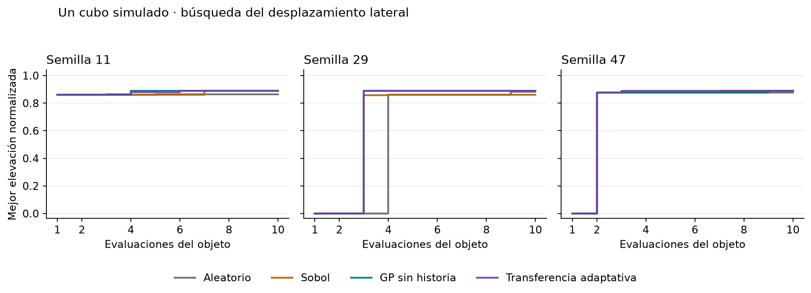

# Búsqueda lateral sobre un agarre propuesto por AxisForge3D

El CLI integrado produjo un plan para el cubo de 40 mm de la celda de demostración. El puente exige cierre en +X, aproximación vertical e identidad de la orientación del cubo. El centro en el mundo es (0,42; −0,10; 0,4445) m y el del objeto (0,42; −0,10; 0,44) m. Se usa solo la componente lateral del centro local como origen de una búsqueda de ±0,03 m. La simulación de elevación utiliza un efector de dos dedos simplificado, la masa de 0,18 kg y el coeficiente de fricción de 0,6 del proyecto. La comprobación cinemática del candidato inicial no extiende su garantía a todos los desplazamientos. El brazo, la altura de la muñeca y la trayectoria 6D completa no se reproducen en MuJoCo.

Cada método recibió las mismas dos primeras posiciones Sobol, incluidas en las diez evaluaciones. La métrica de trayectoria es la media discreta del mejor valor hasta cada paso: altura mínima sobre el nivel inicial durante el sostén, dividida por 0,10 m y acotada en [0,1]. El criterio adicional de éxito exige al menos 0,08 m durante el sostén, ausencia de contacto con la mesa y deriva relativa ≤0,01 m. Cada colisión inicial consume una evaluación y puntúa cero. Un fallo de infraestructura invalida la trayectoria, conserva el diagnóstico y no se reintenta en el mismo registro. No hubo fallos de infraestructura en estos datos.

| Política | Área media en tres semillas | Intentos que satisfacen el criterio de sostén |
|---|---:|---:|
| Aleatoria | 0,7528 | 9 de 30 |
| Sobol | 0,7850 | 12 de 30 |
| GP solo con datos actuales | 0,7954 | 22 de 30 |
| Mezcla con transferencia adaptativa | 0,7974 | 23 de 30 |

La diferencia media adaptativa menos GP es aproximadamente +0,0020 y cambia de signo entre semillas. Son tres búsquedas sobre un cubo. Los 30 intentos de cada política están vinculados por el algoritmo; no constituyen 30 réplicas independientes. No hay estimación de efecto poblacional ni comparación de eficiencia total a idéntico coste histórico. La mezcla recibió 18 evaluaciones adicionales de dos condiciones físicas del mismo cubo, completadas antes de la tarea objetivo. El descriptor geométrico es idéntico en ambas fuentes. Este ensayo no utiliza DINO ni mide transferencia visual entre objetos.

El JSON registra proyecto, binario y plan por SHA-256, configuración, versiones, pesos anteriores a cada observación, resultados y costes de simulación y decisión. La agregación se genera exclusivamente a partir de esos registros. [Datos](run.json) · [Tabla por semilla](paired.csv) · [Configuración](../../../configs/pilot_study/cube.json) · [Protocolo físico](../../methodology/PHYSICS.md)
